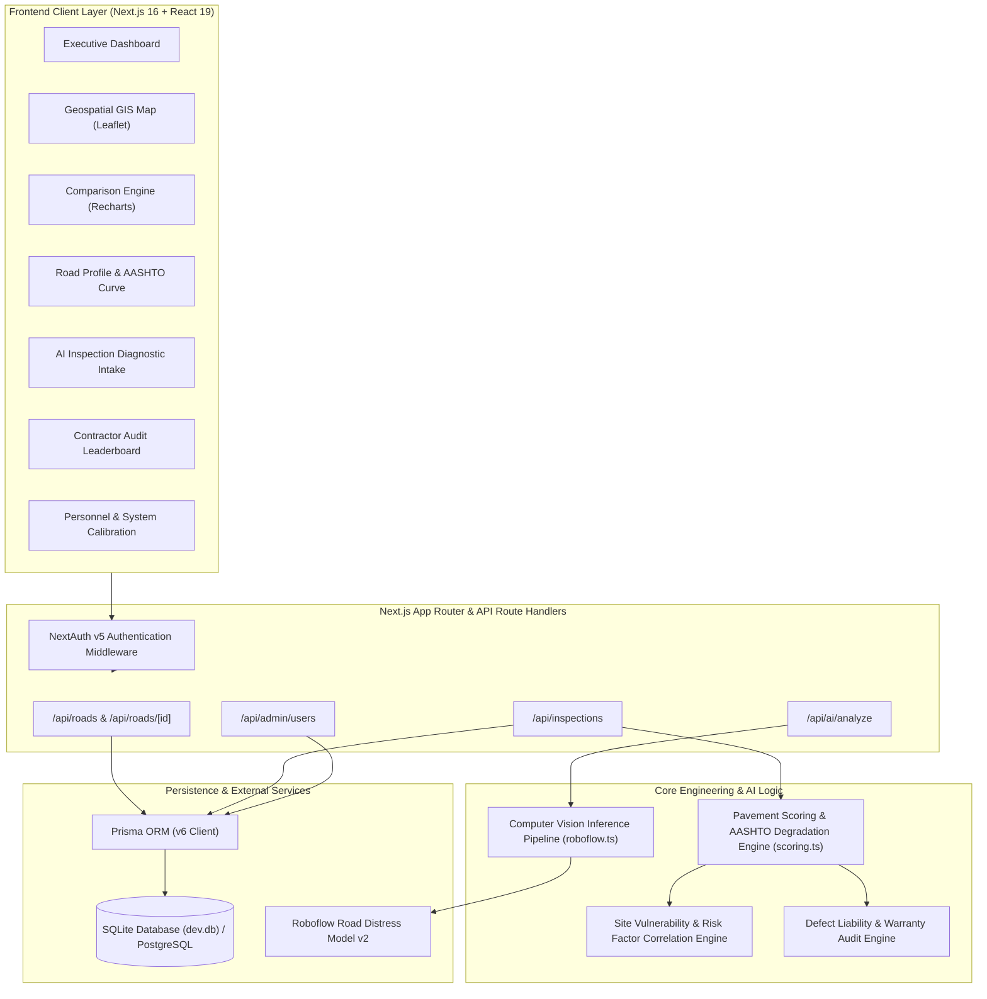
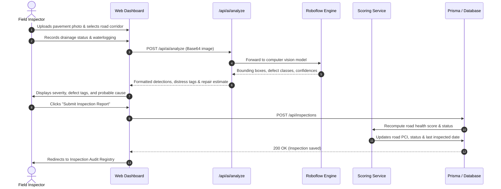
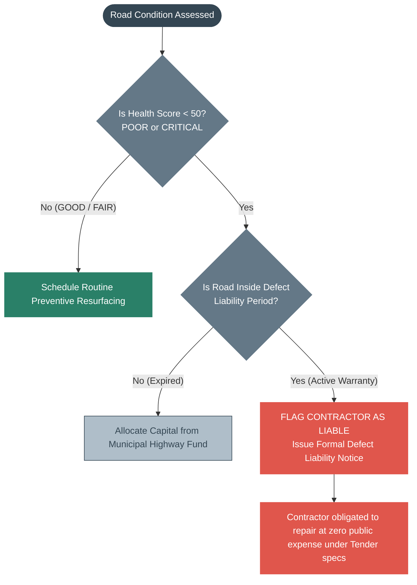
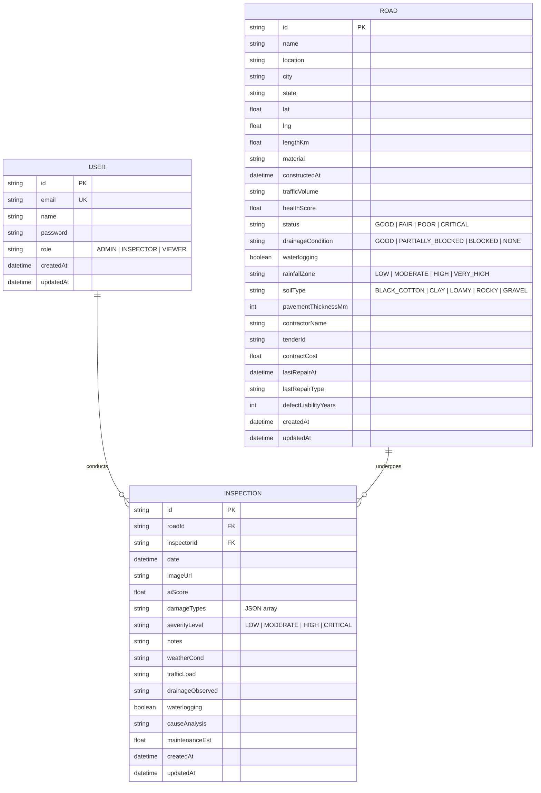

# RoadIQ — System Architecture & Role Documentation

> **AI-Powered Road Asset Intelligence, Pavement Health Analytics, and Contractor Warranty Auditing System**

---

## 1. Executive Summary

**RoadIQ** is a full-stack civil engineering intelligence platform designed for transportation departments, municipal corporations, and highway authorities. It combines **computer vision pavement distress detection**, **ASTM D6433 / AASHTO pavement condition index (PCI) lifecycle modeling**, **site risk factor correlation** (subgrade soil, drainage, and rainfall), and **contractor defect liability auditing** to ensure evidence-based maintenance and public funds accountability.

---

## 2. User Roles & Access Control (RBAC)

The system enforces three distinct role tiers:

| Role | Target Persona | Permissions & Capabilities |
| :--- | :--- | :--- |
| **`ADMIN`** | Chief Municipal Engineer, PWD Director, Executive Auditor | • Full system administration. • Personnel management (create staff, reassign roles between Admin/Inspector/Viewer). • System calibration (PCI deduction thresholds, computer vision confidence cutoff, $/m² resurfacing rates). • Register and delete road assets. • Contractor warranty enforcement and defect notice tracking. |
| **`INSPECTOR`** | Field Quality Engineer, Certified Pavement Auditor | • Conduct and submit computer vision pavement audits (`/dashboard/inspections/new`). • Record on-site drainage observations and waterlogging conditions. • Register newly commissioned road segments (`/dashboard/roads/new`). • Access geospatial map, comparative analysis, and individual asset profiles. |
| **`VIEWER`** | Financial Analyst, Agency Stakeholder, Public Auditor | • Read-only access to all dashboards, geospatial map, comparison engine, and contractor leaderboard. • Prohibited from registering roads, altering personnel, modifying settings, or submitting inspections. |

### Role-Based Access Control Matrix

```mermaid
graph TD
    classDef admin fill:#344653,stroke:#344653,color:#ffffff;
    classDef inspector fill:#647887,stroke:#647887,color:#ffffff;
    classDef viewer fill:#AFBEC9,stroke:#344653,color:#344653;
    classDef action fill:#F7F7F4,stroke:#AFBEC9,color:#344653;

    A[Admin User]:::admin
    B[Inspector User]:::inspector
    C[Viewer User]:::viewer

    P1[Manage Personnel & Roles]:::action
    P2[System Calibration & Settings]:::action
    P3[Register New Road Segment]:::action
    P4[Submit AI Damage Inspection]:::action
    P5[Observe On-Site Drainage]:::action
    P6[View Geospatial Map & Profiles]:::action
    P7[Multi-Road Comparison Tool]:::action
    P8[Contractor Quality Leaderboard]:::action

    A --> P1
    A --> P2
    A --> P3
    A --> P4
    A --> P6
    A --> P7
    A --> P8

    B --> P3
    B --> P4
    B --> P5
    B --> P6
    B --> P7
    B --> P8

    C --> P6
    C --> P7
    C --> P8
```

---

## 3. System Architecture & Core Services

RoadIQ is designed around modular, loosely-coupled services connected through Next.js 16 App Router and Prisma ORM:

---

## 4. Subsystem & Service Breakdown

### 4.1 Pavement Health & Degradation Scoring Service (`src/lib/scoring.ts`)
- **Weighted Recency:** Computes the overall Pavement Condition Index (PCI) on a 0–100 scale using a weighted exponential moving average of recent inspections.
- **Defect Impact Penalties:** Distresses are penalized based on structural hazard (Potholes: -30, Alligator/Fatigue Cracking: -25, Rutting: -20, Longitudinal Cracks: -10).
- **Post-Repair Filtering:** When a road undergoes resurfacing or mill-and-overlay, inspections conducted prior to `lastRepairAt` are archived to accurately reflect the restored pavement life.

### 4.2 Computer Vision Inference Service (`src/lib/roboflow.ts`)
- Detects surface distresses from field photos using custom-trained models.
- **Normalized Distress Classes:** Standardizes raw detections into ASTM standard classifications:
  - `D00`: Longitudinal Crack
  - `D10`: Transverse Crack
  - `D20`: Alligator (Fatigue) Crack
  - `D40`: Pothole
  - `Rutting`, `Delamination`
- **Simulation Fallback:** Seamless fallback with deterministic heuristic inference if external API keys or networks are offline, ensuring continuous system demonstration.

### 4.3 Site Condition & Deterioration Risk Service
Correlates pavement distress with environmental and geological site factors:
- **Drainage:** Good, Partially Blocked, Blocked, or None.
- **Waterlogging:** Active surface pooling flag.
- **Subgrade Soil:** Black Cotton (expansive clay), Clay, Loamy, Sandy, Gravel, Rocky.
- **Rainfall Zone:** Low, Moderate, High, Very High.
- **Composite Priority:** `priorityScore(healthScore, riskScore)` combines visual distress with site risk to generate a 0–100 urgent intervention priority index.

### 4.4 Contractor Defect Liability & Warranty Audit Service
- Automatically cross-references a road's condition against its **Defect Liability Period (DLP)** and contract value.
- **Contractor Liability Trigger:** When a road degrades to `POOR` or `CRITICAL` while still within its warranty window, the system flags the contractor as **Liable**, generates a formal defect remediation recommendation, and highlights tender information.

---

## 5. End-to-End Inspection & Assessment Sequence

---

## 6. Contractor Liability & Action Workflow

---

## 7. Data Model Entity Relationship Diagram (ERD)

---

## 8. REST API Reference

| Endpoint | Method | Role Required | Description |
| :--- | :--- | :--- | :--- |
| `/api/auth/[...nextauth]` | `POST` | Public | NextAuth credentials sign-in & session token generation. |
| `/api/roads` | `GET` | Viewer+ | Retrieve all registered roads. Supports `?status=...` and `?includeInspections=true`. |
| `/api/roads` | `POST` | Inspector+ | Register a new road segment with geometric and contract specs. |
| `/api/roads/[id]` | `GET` | Viewer+ | Fetch comprehensive profile of a road including inspection history. |
| `/api/roads/[id]` | `PATCH` | Inspector+ | Update site conditions, drainage, and contractor details. |
| `/api/inspections` | `GET` | Viewer+ | Retrieve master inspection ledger with road & inspector details. |
| `/api/inspections` | `POST` | Inspector+ | Submit new AI inspection report and automatically update road PCI. |
| `/api/ai/analyze` | `POST` | Inspector+ | Run Roboflow computer vision analysis on uploaded pavement imagery. |
| `/api/admin/users` | `GET` | Admin | Retrieve user roster with completed inspection counts. |
| `/api/admin/users` | `POST` | Admin | Create new agency personnel accounts. |
| `/api/admin/users` | `PATCH` | Admin | Reassign user roles between Admin, Inspector, and Viewer. |

---

## 9. Default Demo Credentials

| Role | Email | Password | Intended Test Purpose |
| :--- | :--- | :--- | :--- |
| **Admin** | `admin@roadiq.com` | `admin123` | Personnel roster management, calibration sliders, contractor notices. |
| **Inspector** | `inspector@roadiq.com` | `inspect123` | Photo upload, drainage observation, registering road corridors. |
| **Viewer** | `viewer@roadiq.com` | `view123` | Read-only benchmarking, interactive map, Recharts comparison curves. |
